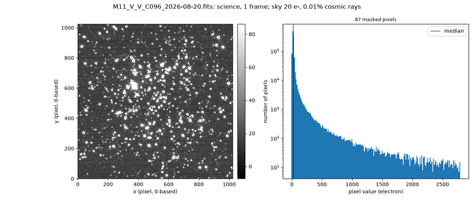
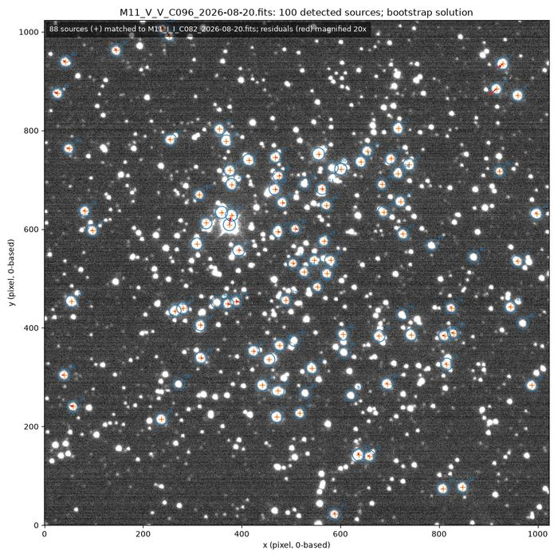
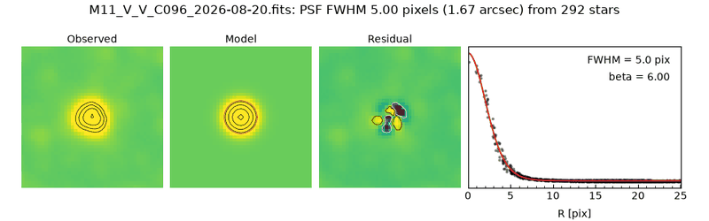
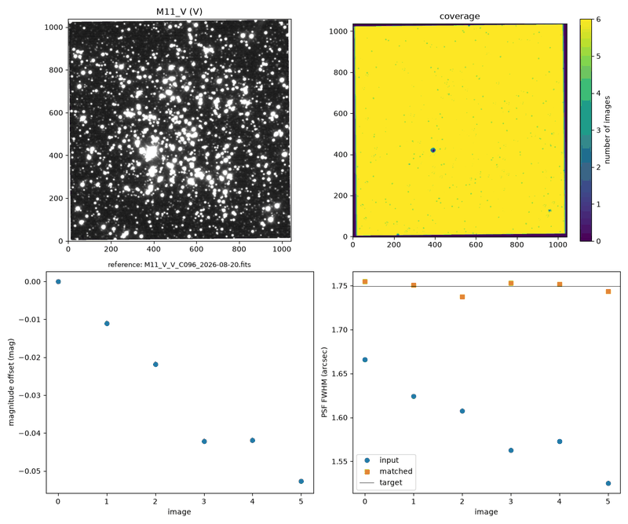
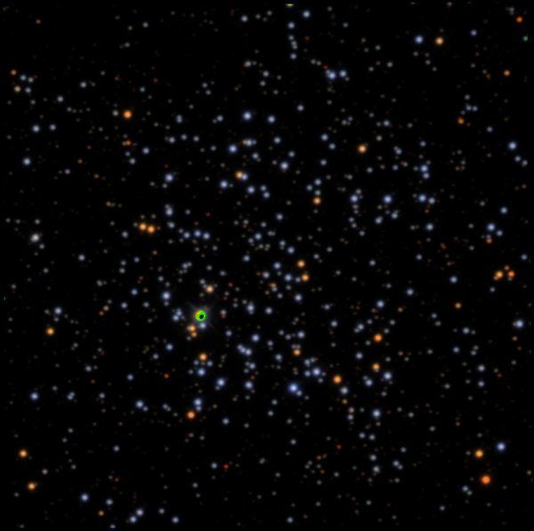

.. _quickstart:

Quick start
===========

This tutorial walks through all of the functionality available through pipnick
as applied to one night of Nickel data.

The excerpts and figures are from commissioning data obtained for the new Andor
camera on UT 2026-08-20, night 3 of a 4-night run.  The data set includes bias
and dome-flat frames, but no sky-flat frames.  Science images include BVRI
images of the open cluster M11 and of the standard-star field SA 111 1965.

Each step discussed below is one command, typically run on the table of the
frames collected into a metadata table by the first step.  Every step ends with
an assessment of the success of the processing (``OK``, ``NEEDS ATTENTION``, or
``FAILED``) and suggests the next command to run.  Although there is an optimal
order, each step can be run at anytime.  The code will raise an error if it does
not have all the required data to complete the step.  And when re-run on a given
dataset, it will only redo processing if something has changed in the results
from one of the previous steps (unless you force it to redo the step).  For more
information along these lines, see :doc:`common`.

Before you start, make sure you have installed pipnick and set up your
astrometry.net API key; see :doc:`install`.

1. Build the tables of raw frames
---------------------------------

First, you must parse relevant metadata from all the raw data.  This data is the
primary information that pipnick needs to plan out how to process your data.  To
build the data table, run:

.. code-block:: console

    pipnick_metadata -d raw -t n3.ecsv --split --assign_mosaics

``-d`` is the directory that contains the raw frames.  ``pipnick_metadata``
reads the header of each file, classifies it, and, with ``--split``, writes one
table per instrument setup.  The instrument setup is determined by unique
combinations of the binning, readout mode, and readout window used to obtain the
observations.  With ``--assign_mosaics``, the science frames are grouped into
mosaics by pointing and filter.

The script will print many messages to the screen as it works, which will look
like this:

.. code-block:: text

    [INFO] - Found 287 data files in raw.
    [INFO] - Camera identified as: NickelAndor
    [INFO] - Assigned 8 mosaics in 2 pointing groups (linking length 2.84 arcmin).
    ...
    Frames per setup (excluding commented rows):
        setup     bias domeflat    focus pointing  science
        A           17        0        0        0        0
        B           10        0        0        0        0
        C           10       33        0        0       58
        D           10       34        0        0       76
        E           10        0        0        0        0
        F           10        0        0        0        0
    ...
    Per-setup files:
        ...
        C: n3_2x2_slow_full.ecsv (101 frames, 0 commented)
        D: n3_2x2_fast_full.ecsv (139 frames, 19 commented)
        ...
    [INFO] - METADATA OK: 268 frames in 6 table(s).

Because this was a commissioning run, we were testing many modes of the camera,
such that the code identified 6 different camera configurations.  A more typical
observing night should only find one.

For the rest of this tutorial, we will focus on reducing the data identified as
setup D, ``n3_2x2_fast_full.ecsv``.  Setup C would be reduced the same way, in
its own reduction directory.

.. important::

    **It is critical that you inspect the output table!**

The output file is in `ECSV
<https://docs.astropy.org/en/stable/io/ascii/ecsv.html>`__ format, a plain text
file that you will likely need to directly edit.  The most important edits to
make are: comment out bad frames (place a ``#`` character at the beginning of
the line), correct object names, filters, and frame types (``bias``,
``domeflat``, etc), and change which frames are combined (``comb_id``) or
mosaicked (``mosaic``, ``wcs_group``).  Frames identified as either focus or
pointing observations should automatically be commented out.  For additional
information, including the meaning for the different combination columns
(``comb_id``, ``mosaic``, ``wcs_group``), see :doc:`metadata`.

2. Reduce the images
--------------------

.. code-block:: console

    pipnick_reduce -t n3_2x2_fast_full.ecsv -r rdx

The bias and the dome flats of each filter are combined, and each science
frame is bias-subtracted, flat-fielded, and cleaned of cosmic rays.  ``-r``
sets the reduction directory, which is saved to the table, so the later steps
need only ``-t``.

.. code-block:: text

    [INFO] -     Frames: 10 bias, 34 domeflat, 76 science; 81 products to reduce.
    ...
    [INFO] - Bias.fits: bias level 301.2 ADU (expected) OK.
    [INFO] - Bias.fits: read noise 6.62 e- (nominal 6.09 e-) OK.
    [INFO] - Reduction summary (also in reduce/summary.ecsv):
                  file           frametype comb_id filter nframes status ...  level    sky  cr_frac    bias         flat
    ---------------------------- --------- ------- ------ ------- ------ ... -------- ----- ------- --------- ---------------
                       Bias.fits      bias       4      V      10  built ...       --    --      --        --              --
                 DomeFlat_V.fits  domeflat     105      V      25  built ...  5323.19    --      -- Bias.fits              --
    ...
    M11_V_V_C096_2026-08-20.fits   science      96      V       1  built ...       -- 19.70  0.0001 Bias.fits DomeFlat_V.fits
    ...
    [INFO] - REDUCTION OK: 81 products (0 up to date, 81 built, 0 failed); summary in reduce/summary.ecsv.

The reduced images are written to ``rdx``, named for their object, filter,
combination group, and date (the object of these frames is "M11 V", so the
filter appears twice).  Each step writes QA figures by default; e.g.,
``rdx/reduce/qa/M11_V_V_C096_2026-08-20.png``:

   A reduced image of M11 in V, and the histogram of its pixel values.

See :doc:`reduce`.

3. Solve the astrometry
-----------------------

First, check what would be done, without submitting anything:

.. code-block:: console

    pipnick_astrometry -t n3_2x2_fast_full.ecsv --dry_run

.. code-block:: text

    ...
        Reference if a submission is needed: M11_I_I_C082_2026-08-20.fits
        Order of any submissions: SA_111_1965_V_V_C020_2026-08-20.fits, M11_I_I_C082_2026-08-20.fits
    2 groups without a solved image.  At least 1 and, if all bootstrapping fails, at most 76 astrometry.net submissions would be made.
    [INFO] - ASTROMETRY OK: dry run of 76 images.

Then solve the images:

.. code-block:: console

    pipnick_astrometry -t n3_2x2_fast_full.ecsv

pipnick submits as few images as possible to astrometry.net (by default, only
the positions of the brightest sources are sent, not the image).  The other
images are solved locally: by matching their sources to those of a solved
image with a similar pointing (*bootstrapping*), or to the Gaia catalog.
Typically, one submission solves a whole night; here, the other images were
bootstrapped from one solved image of SA 111 1965, and M11 was solved by
matching to Gaia.  The submissions are cached, so a rerun submits nothing.

One image was not solved:

.. code-block:: text

    [WARNING] - SA_111_1965_V_V_C131_2026-08-20.fits is not solved: 9 of the 17 sources in
    SA_111_1965_V_V_C131_2026-08-20.fits matched the 413 Gaia sources expected in or near the field
    in the wide search (minimum is 10). ...

Only 17 sources were detected in it, and its seeing is poor (see below).  It
is not worth more effort: we exclude it from the mosaics in step 6.  Each
solved image has a QA figure, e.g.,
``rdx/astrometry/qa/M11_V_V_C096_2026-08-20.png``:

   The sources detected in an image of M11 (blue circles), those matched by
   the solution (orange crosses), and their residuals (red, magnified 20
   times).

See :doc:`astrometry`.

4. Measure the sources
----------------------

.. code-block:: console

    pipnick_photometry -t n3_2x2_fast_full.ecsv

Each image gets a PSF model and a source table with PSF and aperture
photometry, ``rdx/photometry/<image>_phot.ecsv``.

.. code-block:: text

    [WARNING] - PHOTOMETRY NEEDS ATTENTION: 76 images ...; median FWHM 1.56 arcsec; summary in photometry/summary.ecsv.
        ATTENTION: SA_111_1965_V_V_C123_2026-08-20.fits: the PSF FWHM is 5.38 arcsec, outside the expected range (0.80-3.50 arcsec).  Check the focus and tracking.
        ATTENTION: SA_111_1965_V_V_C127_2026-08-20.fits: the PSF FWHM is 5.10 arcsec, outside the expected range (0.80-3.50 arcsec).  Check the focus and tracking.
        ATTENTION: SA_111_1965_V_V_C131_2026-08-20.fits: the PSF FWHM is 3.55 arcsec, outside the expected range (0.80-3.50 arcsec).  Check the focus and tracking.

Three images of SA 111 1965 have poor seeing; we come back to them in
step 6.  The PSF model of each image is shown in
``rdx/photometry/qa/<image>_psf.png``:

   The PSF of an image of M11: the observed stars, the Moffat model, the
   residual, and the radial profile.

See :doc:`photometry`.

5. Calibrate the photometry
---------------------------

.. code-block:: console

    pipnick_calibrate -t n3_2x2_fast_full.ecsv --terms zp --min_stars 1 --apply both

The standard stars observed during the night are identified, and the
calibration of each band is fit to their measurements and applied to every
image: ``--apply both`` writes the calibrated source tables,
``rdx/calibrate/<image>_cal.ecsv``, and records the zero points in the image
headers, so that the mosaics are calibrated too.

By default, the calibration fits a zero point, a color term, and the
extinction, which needs several standard stars at different airmasses.  This
night has only two standard stars in each band, so only the zero point is fit
(``--terms zp``), and the minimum number of stars is lowered (``--min_stars
1``).  With fewer standards, the calibration is less certain: check its RMS.

.. code-block:: text

    [INFO] - Calibration summary (also in calibrate/summary.ecsv):
      night    band status n_stars n_meas n_rejected  rms  rms_loo extinction k_airmass   zp   drift  action
    ---------- ---- ------ ------- ------ ---------- ----- ------- ---------- --------- ------ ------ ------
    2026-08-20    B     ok       2     11          1 0.072   0.075       none        -- 23.068  0.003    fit
    2026-08-20    V     ok       2     23          1 0.053   0.054       none        -- 23.278  0.008    fit
    2026-08-20    R     ok       2     13          0 0.059   0.095       none        -- 23.362  0.015    fit
    2026-08-20    I     ok       2      8          0 0.094   0.172       none        -- 22.875 -0.018    fit
    [INFO] - CALIBRATION OK: 4 of 4 bands calibrated; summary in calibrate/summary.ecsv.

See :doc:`calibrate`.

6. Build the mosaics
--------------------

Every image assigned to a mosaic must have an astrometric solution, so first
remove the unsolved image from its mosaic: in the table, clear its ``mosaic``
and ``wcs_group`` labels,

.. code-block:: text

    n3250.fits science 131 SA_111_1965_V SA_111_1965 "SA 111 1965 V" V ...

becomes

.. code-block:: text

    n3250.fits science 131 "" "" "SA 111 1965 V" V ...

Then:

.. code-block:: console

    pipnick_mosaic -t n3_2x2_fast_full.ecsv

The images of each mosaic are matched to a common PSF, scaled to a common
flux level, reprojected, and combined.  All of the mosaics of a WCS group (here,
the B, V, R, and I mosaics of M11) share the same pixel grid.

.. code-block:: text

    [WARNING] - The PSF FWHM of SA_111_1965_V_V_C123_2026-08-20.fits (5.38 arcsec) is much larger than the median (1.54 arcsec), and sets the target of the PSF matching. ...
    ...
    [INFO] - Mosaic summary (also in mosaic/summary.ecsv):
        mosaic     wcs_group  filter nimages nscaled target_fwhm    status          file        reason
    ------------- ----------- ------ ------- ------- ----------- ----------- ------------------ ------
            M11_B         M11      B       3       3        1.93 constructed         M11_B.fits      -
            M11_I         M11      I       6       6        1.72 constructed         M11_I.fits      -
            M11_R         M11      R       8       8        1.78 constructed         M11_R.fits      -
            M11_V         M11      V       6       6        1.75 constructed         M11_V.fits      -
    SA_111_1965_B SA_111_1965      B       7       7        2.47 constructed SA_111_1965_B.fits      -
    SA_111_1965_I SA_111_1965      I      12      12        1.91 constructed SA_111_1965_I.fits      -
    SA_111_1965_R SA_111_1965      R      14      14        1.83 constructed SA_111_1965_R.fits      -
    SA_111_1965_V SA_111_1965      V      19      18        5.65 constructed SA_111_1965_V.fits      -
    [INFO] - MOSAICS OK: 8 mosaics (8 constructed, 0 up to date, 0 failed); summary in mosaic/summary.ecsv.

The mosaics are written to ``rdx/mosaic``.  The poorest seeing of a mosaic
sets its resolution, so the two images of SA 111 1965 in V with a FWHM above
5 arcsec degrade its V mosaic to 5.65 arcsec.  To improve it, clear their
labels too and rerun ``pipnick_mosaic``: only the mosaics of that WCS group
are rebuilt.  The QA figure of each mosaic, e.g., ``rdx/mosaic/qa/M11_V.png``,
shows the mosaic, its coverage, the flux scale of each image, and the PSF
matching:

   The V mosaic of M11.

See :doc:`mosaic`.

7. Make a colour image
----------------------

.. code-block:: console

    cd rdx/mosaic
    pipnick_rgb M11_R.fits M11_V.fits M11_B.fits -o M11.png

   M11 in R, V, and B (north is up and east is left).

See :doc:`rgb`.

8. Check the results
--------------------

.. code-block:: console

    pipnick_status -t n3_2x2_fast_full.ecsv
    pipnick_report -t n3_2x2_fast_full.ecsv

``pipnick_status`` prints the state of every step for every image, and the
images that need attention:

.. code-block:: text

                   image                     ... reduced   wcs    rms  phot nsrc fwhm calibrated   zp   mosaic attention
    ------------------------------------     ... ------- ------- ----- ---- ---- ---- ---------- ------ ------ ---------
            M11_V_V_C096_2026-08-20.fits     ...      ok      ok 0.075   ok 1147 1.67         ok 23.278     ok
    ...
    SA_111_1965_V_V_C123_2026-08-20.fits     ...      ok      ok 0.141   ok   48 5.38         ok 23.278     ok      fwhm
    ...
    SA_111_1965_V_V_C131_2026-08-20.fits     ...      ok missing    --   ok   48 3.55         ok 23.278    n/a      fwhm
    ...
    [WARNING] - 3 image(s) need attention (see the attention column): SA_111_1965_V_V_C123_2026-08-20.fits, SA_111_1965_V_V_C127_2026-08-20.fits, SA_111_1965_V_V_C131_2026-08-20.fits

``pipnick_report`` collects the summaries and QA figures of every step in an
HTML report; open ``rdx/report/index.html`` in a browser.  To follow one image
or source through the steps, use ``pipnick_inspect``.  See :doc:`checking`.

The products
------------

At the end, the reduction directory holds:

- the reduced images, ``rdx/<image>.fits``, with their astrometric solutions
  and photometric zero points in their headers;
- the calibrated source catalogs, ``rdx/calibrate/<image>_cal.ecsv``;
- the mosaics, ``rdx/mosaic/<mosaic>.fits``, in e-/s with the zero point in
  ``PHOTZP``;
- the summary, QA figures, and log of every step.

See :doc:`common` for the layout of the reduction directory.
